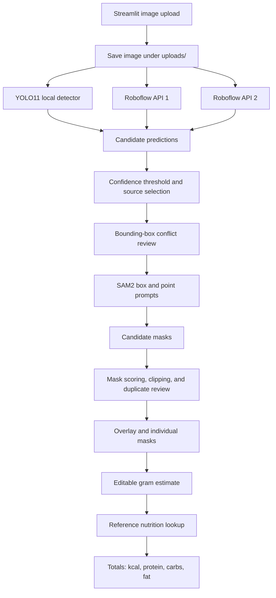
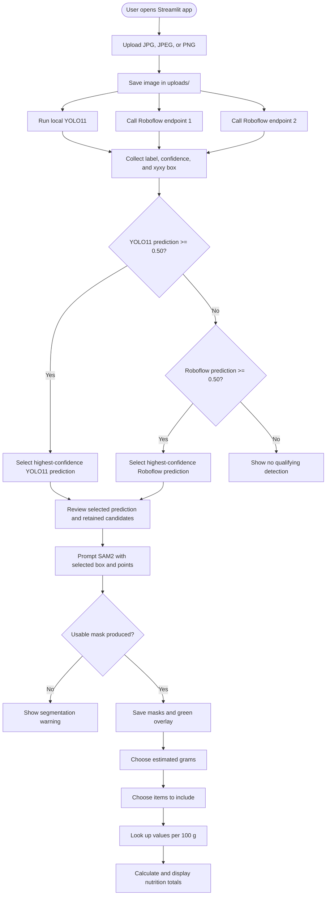
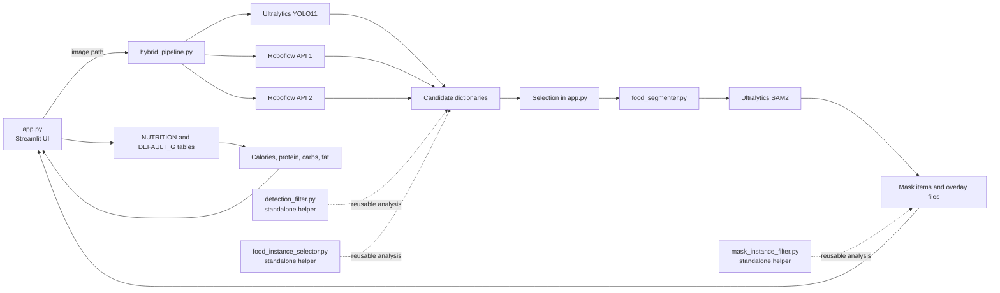
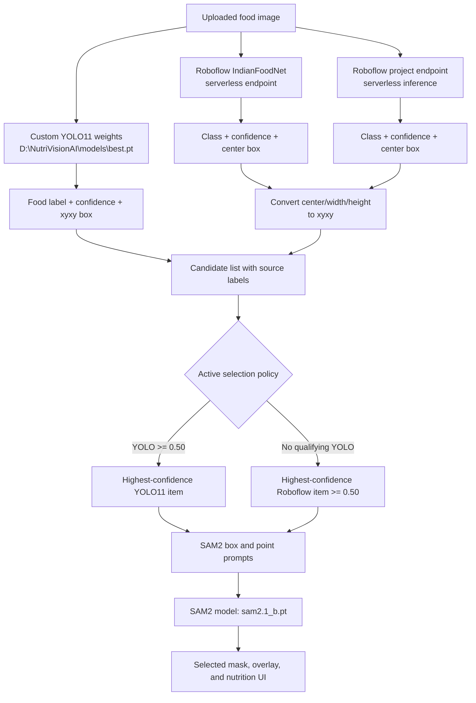
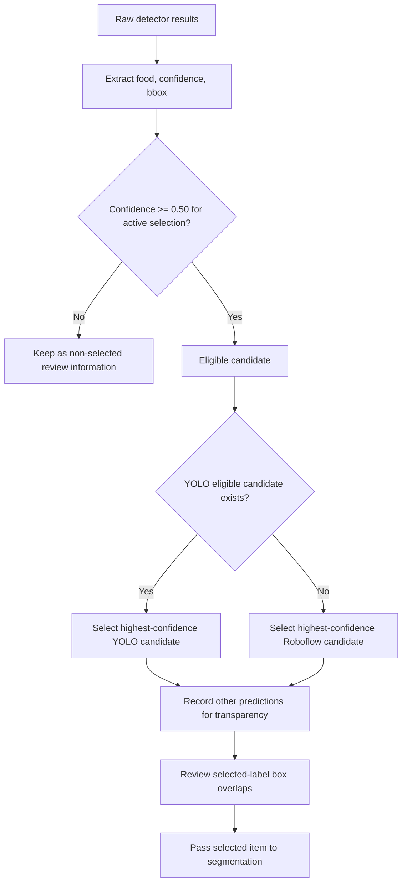
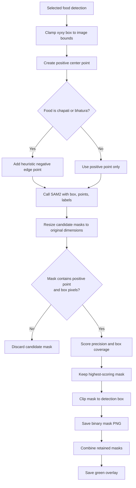
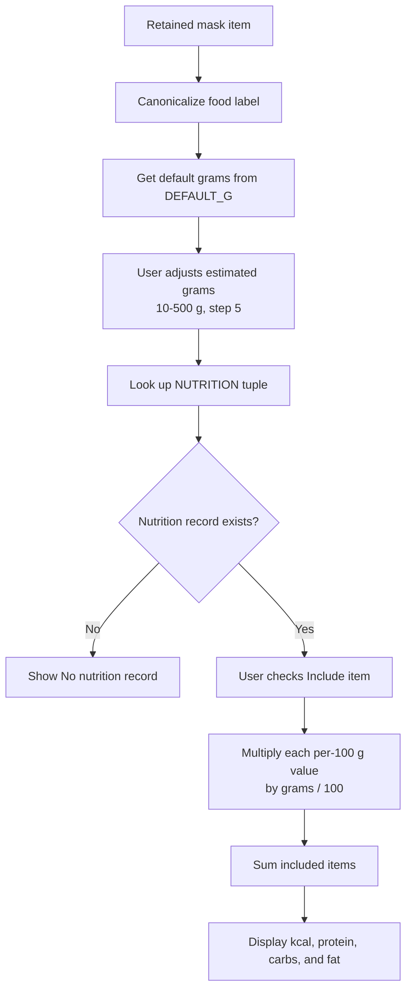
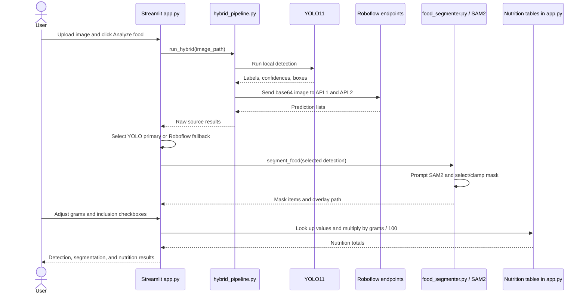

# NutriVisionAI

Hybrid food recognition, segmentation, and nutrition-estimation application for
food images.

> **Documentation status:** This README describes the implementation currently
> present in this repository. It does not claim model accuracy, dataset
> coverage, or production readiness because those values are not reported by
> the source code.

## Overview

NutriVisionAI is a Streamlit application that accepts a JPG, JPEG, or PNG food
image and produces:

1. Food predictions from a custom YOLO11 model and two Roboflow inference
   endpoints.
2. A selected detection for downstream processing, using YOLO11 as the primary
   source when it has a prediction with confidence of at least 50%.
3. A pixel-level mask for the selected detection using Ultralytics SAM2.
4. A visual mask overlay and individual mask images.
5. An editable portion estimate and approximate calories, protein,
   carbohydrates, and fat based on an in-code reference table.

The application is intended as an assistive estimation tool. It does not
measure food mass, identify ingredients chemically, or provide medical or
dietary advice.

## Abstract

The project combines object detection, cloud-based food recognition, prompted
image segmentation, overlap analysis, and portion-based nutrition arithmetic
in a single workflow. Multiple recognition sources are retained for
transparency, while conservative selection and duplicate filtering reduce the
chance that the same visual item is counted more than once. SAM2 then turns a
selected bounding box into a constrained mask that can be inspected before
nutrition is included in the total.

## Problem Statement

A food photograph can contain several dishes, side dishes, visually similar
foods, and overlapping predictions from different models. A classification
label alone does not show which pixels belong to the food or whether multiple
predictions refer to the same serving. In addition, nutrition depends strongly
on recipe, preparation, and portion size. NutriVisionAI addresses these
problems by combining model evidence with bounding-box and mask review, then
making the portion assumption explicit and editable.

## Objectives

- Detect common Indian foods and accompaniments in uploaded images.
- Combine local YOLO11 evidence with two independent Roboflow responses.
- Normalize common spelling and label variants before comparing predictions.
- Select a conservative detection for segmentation and nutrition.
- Generate and save inspectable SAM2 masks and overlays.
- Identify duplicate detections and high-overlap label conflicts.
- Provide transparent, editable nutrition estimates rather than implying
  measured values.

## Key Features

- Streamlit upload interface with JPG/JPEG/PNG validation.
- Custom YOLO11 inference with bounding boxes and confidence scores.
- Two Roboflow serverless detection calls.
- Primary-model/fallback policy:
  - highest-confidence YOLO11 prediction at or above `0.50`, or
  - highest-confidence Roboflow prediction at or above `0.50` if YOLO11 has
    none.
- Label canonicalization for variants such as rice/plain rice, chapati
  spellings, sambar/sambhar, papad/papadam, and yogurt/curd variants.
- Reusable same-label bounding-box duplicate suppression using box IoU.
- Reusable cross-label overlap reporting without silently deleting conflicting
  labels.
- Prompted SAM2 segmentation using the selected bounding box and a positive
  center point.
- Flatbread-specific negative prompt heuristic for chapati and bhatura.
- Mask selection based on box containment, box coverage, and positive-point
  inclusion.
- Mask clipping to the selected detection box.
- Individual binary mask PNGs and a combined green overlay.
- Reusable same-label mask duplicate suppression using mask IoU `>= 0.90`;
  the active UI currently selects one detection.
- Editable portion sliders from 10 g to 500 g in 5 g increments.
- Per-item inclusion checkboxes and aggregate calorie/macronutrient totals.
- Review warnings for detection and mask conflicts.

## Technologies and Tools

| Area | Technology or library | Use in the project |
|---|---|---|
| UI | Streamlit | Uploads, tables, warnings, previews, sliders, and metrics |
| Language | Python | Application and processing code |
| Detection | Ultralytics YOLO11 | Local food detection and bounding boxes |
| Segmentation | Ultralytics SAM2 (`sam2.1_b.pt`) | Prompted pixel masks |
| Cloud inference | Roboflow serverless APIs | Two additional food-detection sources |
| Image processing | OpenCV | Image reading, resizing, mask writing, overlays |
| Image objects | Pillow | Streamlit image loading and overlay saving |
| Numerical processing | NumPy | Array operations, masks, and IoU |
| HTTP | Requests | Roboflow API requests |
| Environment loading | python-dotenv | Loads `ROBOFLOW_API_KEY` from `.env` |
| ML runtime | PyTorch/TorchVision | Ultralytics model execution |

Pinned package versions are listed in
[requirements.txt](requirements.txt). The repository does not include a
separate `pyproject.toml`, `setup.py`, or lock file.

## System Architecture



## Overall Project Workflow

1. `app.py` creates the `uploads/` and
   `segmentation_results/app_runs/latest/` directories if needed.
2. A user uploads an image through Streamlit.
3. The image is saved as `uploads/nutrivision_input.<suffix>`.
4. `hybrid_pipeline.py` runs:
   - the local YOLO11 model;
   - Roboflow endpoint 1 (`indianfoodnet/1`);
   - Roboflow endpoint 2 (`my-first-project-4cb9f/1`).
5. Each detector returns a food label, confidence, and `[x1, y1, x2, y2]`
   bounding box. Roboflow center/width/height boxes are converted to xyxy.
6. The app adds a source name to each candidate and applies its selection
   policy. Non-selected predictions remain available in the UI for
   transparency, but are not segmented or counted in nutrition.
7. The selected item is passed to the active UI's overlap-review helper;
   standalone filtering modules can analyze multiple candidates and suppress
   same-label duplicates using bounding-box IoU.
8. The selected detection is passed to `food_segmenter.py`.
9. SAM2 receives the image, detection box, adaptive point prompt, and mask
   settings. Candidate masks are resized to the original image dimensions.
10. The best mask is chosen using box precision, box coverage, and positive
    prompt inclusion. The mask is clipped to the detection box and saved.
11. If multiple mask items are available, same-food masks with mask IoU at
    least `0.90` are treated as likely duplicates. The combined overlay is
    rebuilt from retained masks. The current one-detection UI normally has at
    most one active mask item.
12. The UI presents mask previews and editable gram estimates.
13. For each included item, the app calculates nutrition from the reference
    values per 100 g and sums the selected items.

The active Streamlit workflow is implemented by `app.py`, `hybrid_pipeline.py`,
and `food_segmenter.py`. The versioned `hybrid_engine*.py` files and
`hybrid_detector*.py` files are alternate or historical decision engines; they
are not all called by the current UI.

### Complete Project Workflow Flowchart



This flowchart reflects the current one-detection selection policy and the
fact that segmentation and nutrition stop when no qualifying detection or
usable mask is available.

### Application Data Flow Diagram



The solid arrows represent the active Streamlit path. Dashed arrows represent
helper modules that provide reusable or diagnostic filtering logic but are not
all invoked by the active `analyze()` function. The active UI selects one
detection before segmentation, so multi-candidate duplicate and conflict
analysis is primarily available through the standalone helpers.

## Detailed Model Architecture and Integration



YOLO11 supplies local detections and is preferred by the active UI. The
Roboflow services provide fallback detections when YOLO11 has no qualifying
prediction. The source code also contains weighted hybrid engines, but those
alternate engines are not the selection path used by `app.py`.

### Model Integration Flowchart

```mermaid
flowchart TD
    A[Image path] --> B[run_yolo()]
    A --> C[run_api1()]
    A --> D[run_api2()]
    B --> E[YOLO detections]
    C --> F[Roboflow API 1 detections]
    D --> G[Roboflow API 2 detections]
    E --> H[Add source = yolo]
    F --> I[Add source = api1]
    G --> J[Add source = api2]
    H --> K[Combined candidates]
    I --> K
    J --> K
    K --> L{Any YOLO confidence >= 0.50?}
    L -->|Yes| M[Use highest-confidence YOLO item]
    L -->|No| N{Any Roboflow confidence >= 0.50?}
    N -->|Yes| O[Use highest-confidence Roboflow item]
    N -->|No| P[Return no selected item]
```

`hybrid_pipeline.py` returns all three raw result lists plus the result of its
alternate `hybrid_decision()` call. The active `app.py` uses the raw lists and
its own primary/fallback policy for segmentation.

## Food Detection Process

### Food Detection and Filtering Flowchart



The active `app.py` makes the one-item selection shown above. The standalone
`detection_filter.py` and `food_instance_selector.py` modules additionally
provide validation, label normalization, IoU-based duplicate suppression,
cross-label overlap reporting, and a known rice/coconut-chutney conflict rule
for development and diagnostic workflows. The active call to
`review_cross_label_overlaps()` receives only the selected item, so it does
not perform multi-label overlap analysis in the current UI. The helper
`app.suppress_same_food_duplicates()` is defined with a box-IoU threshold of
`0.50`, but the active `analyze()` path selects its single item before calling
that helper.

### Label Normalization and Conflict Review

Labels are normalized by removing spaces and punctuation and applying
selected aliases. Examples include `chapathi`/`chappathi` to `chapati`,
`sambhar` to `sambar`, and `papad` to `papadam`. Different labels are not
automatically treated as duplicates. High-overlap different-label detections
are surfaced for review.

## SAM2 Segmentation Process

### SAM2 Segmentation Flowchart



`food_segmenter.py` does not claim semantic correctness from the prompts. It
records mask area and mask coverage ratio so the result can be inspected in
the UI. Because the active selection policy passes one detection to
segmentation, duplicate-mask and cross-label mask-conflict checks are
reusable safeguards rather than typical multi-item behavior in the current
UI.

## Portion Size Estimation

The active UI does not infer grams from pixels or mask area. It displays a
food-specific default where one is defined in `DEFAULT_G`; otherwise it uses
100 g. The user can adjust the slider from 10 g to 500 g in 5 g increments
and can include or exclude each item from the total.

### Portion and Nutrition Flowchart



## Detection and Hybrid Recognition

### Local YOLO11

`hybrid_pipeline.py` loads a custom Ultralytics YOLO model from the hard-coded
path `D:\NutriVisionAI\models\best.pt`. It extracts the class name, confidence,
and xyxy coordinates from each result. The repository also contains
`train_food_model.py`, which shows a YOLO11 nano training configuration for an
`IndianFood10` dataset, but the dataset and resulting weights are not included
in this project snapshot.

### Roboflow sources

The two serverless endpoints are called with a base64-encoded image body and
the `ROBOFLOW_API_KEY` environment variable. A missing key causes the
Roboflow helper to return no predictions. Non-200 responses and request
exceptions are reported by the pipeline and produce no results from that
source.

### Selection and review policy

The current UI intentionally uses one detection for segmentation:

- If YOLO11 has any prediction with confidence `>= 0.50`, the highest
  confidence YOLO11 prediction is selected.
- Otherwise, the highest-confidence prediction from either Roboflow source
  with confidence `>= 0.50` is selected.
- If neither condition is met, segmentation and nutrition are unavailable.

This is different from the standalone experimental hybrid decision engines,
which score multiple model predictions to choose an image-level label. The
active Streamlit path calls `run_hybrid()` and applies the selection policy in
`app.py`; it does not use every versioned engine file for the UI result.

## Segmentation Method

`food_segmenter.py` uses Ultralytics SAM with the `sam2.1_b.pt` model name.
For each selected detection it:

- clamps the box to image boundaries;
- creates a positive point at the box center;
- adds a heuristic negative point for chapati and bhatura;
- requests masks with the box and points;
- resizes masks back to the original image dimensions;
- rejects masks that are empty, do not contain the positive point, or have no
  pixels inside the detection box;
- scores remaining masks using:
  `0.60 * mask_precision + 0.40 * min(box_coverage, 1.0)`;
- clips the chosen mask to the detection box;
- records pixel area and mask coverage ratio;
- writes a binary mask PNG and a combined green overlay.

The source explicitly notes that box-derived prompts cannot guarantee
semantic correctness when a detection box contains multiple items. Masks
should therefore be inspected before using nutrition totals.

## Overlap, Filtering, and Conflict Handling

The repository contains several reusable and diagnostic filters:

- `detection_filter.py` validates confidence and boxes, clips boxes to image
  bounds when dimensions are supplied, normalizes labels, and suppresses
  same-label boxes with IoU at least `0.90`.
- `food_instance_selector.py` performs conservative cross-model duplicate
  suppression at IoU `0.85` and reports cross-label overlaps for review. It
  includes a special rice/coconut-chutney conflict rule for high-overlap
  candidates.
- The active `app.py` path contains same-label mask duplicate and conflict
  safeguards at mask IoU `0.90`, but its one-item selection normally leaves
  no multiple masks to compare. Its same-label box duplicate helper is
  available but is not called after the active one-item selection.
- `mask_instance_filter.py` calculates mask IoU and classifies overlapping
  masks as `POSSIBLE_DUPLICATE` or `LABEL_CONFLICT_REVIEW` without modifying
  the input list.

Different labels are generally retained by the reusable helpers and surfaced
for review rather than silently removed. The UI's conflict-warning logic is
available for multiple retained mask items, but the active one-item selection
normally means there are no cross-label masks to compare.

## Nutritional Calculation Methodology

Nutrition data is an in-code dictionary in `app.py`. Each entry is a tuple:

```text
(calories_per_100_g, protein_g_per_100_g,
 carbohydrates_g_per_100_g, fat_g_per_100_g)
```

The calculation for each included item is:

```text
factor = estimated_grams / 100
item_nutrient = reference_value_per_100_g * factor
```

The UI sums calories, protein, carbohydrates, and fat across checked items.
Default portions are food-specific where defined; unknown foods default to
100 g. The user can change each estimate between 10 g and 500 g. Entries
without a matching nutrition record show **No nutrition record** and are not
included in totals.

The values are generic reference averages, not measurements. They do not
account for recipe, cooking method, oil, ingredient substitutions, serving
size uncertainty, or edible/non-edible parts.

## Project Structure

```text
NutriVisionAI-main/
├── app.py                         # Active Streamlit application
├── hybrid_pipeline.py             # YOLO11 + two Roboflow inference sources
├── hybrid_detector.py             # Earlier/alternate weighted decision logic
├── hybrid_engine.py               # Versioned hybrid scoring engine
├── hybrid_detector_new.py         # Alternate hybrid detector implementation
├── hybrid_engine_v3.py ... v10.py # Historical/experimental engine versions
├── food_segmenter.py              # SAM2 prompts, mask selection, and outputs
├── food_instance_selector.py      # Cross-model instance selection and conflicts
├── detection_filter.py            # Detection validation and IoU filtering
├── mask_instance_filter.py        # Mask IoU review helpers
├── utils/
│   ├── food_detector.py           # Small YOLO detector wrapper
│   └── image_preprocessing.py     # RGB/BGR conversion, 640x640 resize, normalize
├── train_food_model.py            # YOLO11 training example
├── app_backup_before_*.py         # Previous Streamlit application snapshots
├── check_box_overlap.py
├── compare_*.py
├── inspect_*.py
├── validate_masks.py
└── visualize_*.py                 # Diagnostics and visualization scripts
```

The many `test_*.py` files exercise or demonstrate detection, API calls,
hybrid scoring, conflict resolution, segmentation, and mask selection. They
are development utilities rather than a packaged test suite with documented
fixtures. Several scripts refer to local paths such as
`D:\NutriVisionAI\test_images\meal.png`.

## Installation Requirements

### Prerequisites

- Python version compatible with the pinned packages in
  [requirements.txt](requirements.txt).
- A local YOLO11 weights file available at the path expected by
  `hybrid_pipeline.py`.
- A SAM2 weights file that Ultralytics can resolve from `sam2.1_b.pt`.
- Roboflow access and an API key if cloud detections are required.
- A CPU or CUDA-capable environment supported by the installed PyTorch and
  Ultralytics versions.

The repository does not include model weights, datasets, test images, or a
documented hardware specification.

### Install dependencies

From the project directory:

```bash
python -m venv .venv

# Windows PowerShell
.\.venv\Scripts\Activate.ps1

python -m pip install --upgrade pip
python -m pip install -r requirements.txt
```

`hybrid_pipeline.py` imports `python-dotenv` for `.env` loading. Confirm that
the environment provides it if dependency installation reports it as missing;
the existing requirements file is the authoritative dependency snapshot for
this repository.

## Configuration and Environment Variables

Create a local `.env` file and set the Roboflow key without committing it:

```dotenv
ROBOFLOW_API_KEY=your_roboflow_api_key
```

Only the variable name is documented here; secrets must never be placed in
this README. The endpoint URLs, YOLO weights path, SAM2 model name, confidence
thresholds, output paths, and nutrition table are currently defined in source
code rather than exposed as environment variables or a configuration file.

Before using a different machine, review the hard-coded
`D:\NutriVisionAI\models\best.pt` path in `hybrid_pipeline.py`. This README
does not change that implementation detail.

## How to Run

The documented application command is:

```bash
streamlit run app.py
```

Then open the local URL shown by Streamlit, upload a food image, and select
**Analyze food**. The first analysis may take longer because model weights may
need to be initialized or resolved by the ML runtime.

This README was written without starting the application, invoking Python
scripts, downloading models, or loading model weights.

## Expected Application Output

For a successful analysis, the UI can show:

- the uploaded image;
- raw and selected detection counts;
- a table containing food, source, confidence, and bounding box;
- suppressed duplicate predictions and duplicate masks;
- cross-label overlap warnings;
- a combined green SAM2 overlay;
- individual mask previews with mask coverage;
- per-item estimated calories;
- editable portion controls and inclusion checkboxes;
- total calories, protein, carbohydrates, and fat.

If no prediction reaches the 50% threshold, or SAM2 produces no usable mask,
the app displays a warning and nutrition totals are unavailable. API failures
can also result in missing predictions from that source.

## Screenshots

Screenshots are not included in the repository snapshot. Suggested captures
for a future release:

```text
<!-- docs/screenshots/upload.png -->
<!-- docs/screenshots/detection-review.png -->
<!-- docs/screenshots/segmentation-overlay.png -->
<!-- docs/screenshots/nutrition-summary.png -->
```

## Optional Interaction Sequence



This sequence describes the active UI interaction. It does not imply that
the versioned hybrid engines are called during the Streamlit request.

## Limitations

- No accuracy, recall, precision, latency, or benchmark results are provided.
- Model weights and the training dataset are not included.
- YOLO weights are referenced through a machine-specific absolute path.
- The active UI selects one detection for segmentation, so it is not a full
  multi-food serving counter.
- SAM2 prompts are derived from detection boxes and may segment a neighboring
  item when boxes contain multiple foods.
- Confidence values are model outputs and are not calibrated nutritional or
  identification probabilities.
- Roboflow inference requires network access and a valid key.
- Nutrition values are generic averages and portion weights are user estimates.
- Food labels not present in the in-code nutrition table cannot contribute to
  totals.
- IoU heuristics can suppress genuinely separate servings that overlap.
- Several diagnostic and historical modules use hard-coded local image paths.
- There is no documented authentication, persistence layer, database, or
  production deployment configuration.

## Future Enhancements

- Replace machine-specific paths with environment-configurable model paths.
- Add a formal configuration layer for endpoints, thresholds, and output
  directories.
- Support multi-instance and multi-food selection with explicit user review.
- Add calibrated confidence reporting and an evaluation protocol.
- Include versioned model artifacts or documented model download steps.
- Add a nutrition data source with provenance, recipe context, and serving
  metadata.
- Improve segmentation prompts and add interactive mask correction.
- Add automated tests with portable fixtures and CI configuration.
- Add structured logging and clearer user-facing handling for API/model errors.
- Provide containerized or cloud deployment documentation.

## Contributors

The repository metadata does not identify a contributor list. The GitHub
repository associated with this project is
[canil9393/NutriVisionAI](https://github.com/canil9393/NutriVisionAI).
Add verified names, roles, and contact links here when they are available.

## Acknowledgements

- [Ultralytics](https://github.com/ultralytics/ultralytics) for the YOLO and
  SAM interfaces used by the source code.
- [Streamlit](https://streamlit.io/) for the application interface.
- [Roboflow](https://roboflow.com/) for the configured serverless inference
  endpoints.

## License

No license file or license declaration was present in the inspected project
snapshot. Unless a license is added by the copyright holder, reuse and
redistribution permissions should be treated as unspecified. Add the
project's verified license text and a badge here before publishing as an
open-source package.
